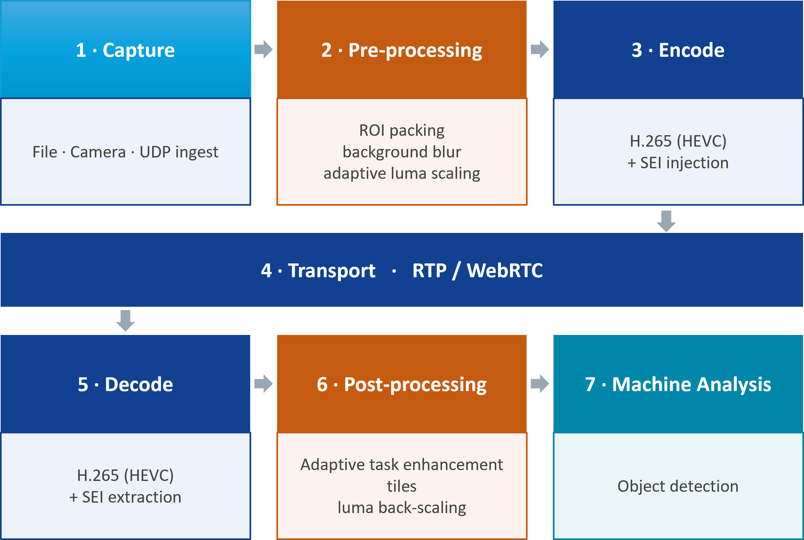

# Video Coding for AI Tasks (VCAI)

## Overview

**Video Coding for AI Tasks (VCAI)** is a deployment-oriented video coding stack for machine-vision and streaming. It combines a **GStreamer-based H.265 (HEVC)** path with lightweight **pre- and post-processing** for AI workloads, optional **neural ROI detection**, and **standards-aligned supplemental enhancement information (SEI)** from encode through transport to decode and display. **PRI**, **EOI**, and related terms are defined in the [glossary](docs/part01/ch03-glossary.md).



### Highlights

- **Industry-ready pipeline** — complete encode → transport → decode/display path for production video products and operational machine-vision workloads
- **AI-oriented pre/post** — ultra-lightweight stages for detection, ROI handling, task enhancement, and receive-side reconstruction
- **Integrated H.265 stack** — GStreamer-powered **HEVC** compression with RTP/WebRTC output in the same toolkit
- **Neural ROI path** — optional detector-driven regions wired into packing, bitrate policy, and receiver overlays
- **Standards-based metadata** — **H.265 prefix SEI** carrying **Packed Regions Information (PRI)** and **Encoder Optimization Information (EOI)** end to end ([details](docs/part03/pri-sei-lifecycle.md))

**Who it's for:** teams building **production** video and machine-vision pipelines—integrated products and operational deployments—not throwaway lab demos alone.

### Pre-processing

- **Adaptive luma adaptation** before encode when analysis-driven tone handling is enabled
- **Semantic-based processing**—ROI region packing and optional background blur around packed regions
- **Adaptive task-enhancement preprocessing** to steer quality toward task-relevant areas

### Post-processing

- **Adaptive task enhancement tiles** on the receive/decode path
- **Adaptive luma back-scaling** to restore or steer luma after decode

## Components

| Component | Role |
|-----------|------|
| [`encoder_cli`](encoder_cli/README.md) | Ingest (file, camera, UDP), detection, ROI packing, H.265 encode, and stream output |
| [`rtp_server`](rtp_server/README.md) | Receive, decode, extract SEI/PRI, overlays, and display or debug capture |
| [`libvcai`](libvcai/README.md) | Shared C++20 core—bitstream/SEI, frame ops, transport helpers, utilities |

Repository map and CMake toggles: [docs/development.md](docs/development.md).

## Requirements

| Area              | Guidance                                                                                         |
| ----------------- | ------------------------------------------------------------------------------------------------ |
| **OS**            | Linux (Ubuntu 22.04+ documented in [INSTALL.md](INSTALL.md))                                     |
| **Hardware**      | 16 GB RAM recommended; **NVIDIA GPU + CUDA** when using the default neural ROI / DeepStream detection path |
| **Stack**         | GStreamer 1.x, CMake, C++20 toolchain; DeepStream, ONNX Runtime, and YOLO export tooling as needed for your features |
| **Codec plugins** | Kvazaar / openhevc often installed via `./scripts/setup/bootstrap.sh` (see [patches/](patches/)) |

The **full ROI and neural detection path** (see [End-to-end flow](#end-to-end-flow)) expects **NVIDIA GPU, CUDA, and DeepStream** with model configuration—you can still build and exercise parts of the stack without them (for example file encode/decode or tests with reduced features).

Full host setup: [INSTALL.md](INSTALL.md). Containers: [docker/DOCKER_USAGE.md](docker/DOCKER_USAGE.md) or [APPTAINER_DEV_ENV.md](APPTAINER_DEV_ENV.md).

## End-to-end flow

Typical runtime flow:

1. `encoder_cli` ingests from file/camera/UDP.
2. Detection and ROI packing run (DeepStream + model config dependent).
3. ROI metadata is serialized and inserted into H.265 SEI.
4. Stream is sent via RTP or WebRTC transport.
5. `rtp_server` receives, decodes, extracts metadata, and overlays ROI/debug info.
6. Output is displayed and optionally recorded/debug-captured.

## Quick start

Contributor-oriented layout, CMake toggles, doc index, and maintenance commands: **[docs/development.md](docs/development.md)**.

### 1) Build prerequisites and core components

```bash
./scripts/setup/bootstrap.sh core
./scripts/setup/bootstrap.sh ds-env   # optional: YOLO/export tooling for model scripts
```

Details: [Host setup bootstrap guide](docs/part07/scripts-setup-readme.md).

### 2) Build applications

```bash
cd encoder_cli && ./build.sh
cd ../rtp_server && ./build.sh
```

### 3) Run applications (two terminals)

Use a **raw YUV** file whose resolution and frame rate match your encoder settings (the example below assumes **1920×1080 @ 30 fps**). The repository does not ship large YUV corpora; use your own capture or convert with `ffmpeg` from another format. Test fixtures and configs live under [`test/common/test_data/`](test/common/test_data/)—see [test/README.md](test/README.md).

Terminal A:

```bash
cd rtp_server
./run.sh rtp
```

Terminal B:

```bash
cd encoder_cli
./run.sh file rtp /path/to/video_1920x1080_30.yuv
```

Notes:

- `rtp_server/run.sh` requires a transport (`rtp` or `webrtc`).
- `encoder_cli/run.sh` requires `<input_mode> <output_mode>` and optional mode-specific args.
- Use `-- --help` to forward help to the underlying binary:
  - `encoder_cli/run.sh -- --help`
  - `rtp_server/run.sh -- --help`

More examples: [encoder_cli/README.md](encoder_cli/README.md), [rtp_server/README.md](rtp_server/README.md).

### 4) Run tests

```bash
cd test
./build.sh      # optional explicit incremental build
./run.sh
```

[`test/run.sh`](test/run.sh) also invokes `./build.sh` before executing tests.

## Third-party components

VCAI builds on and integrates with several upstream projects, including:

- **GStreamer** and related plugins (core media pipeline)
- **Kvazaar** / **gst-kvazaar** and **openhevc** (optional; local builds via `bootstrap.sh`, with changes under [`patches/`](patches/))
- **NVIDIA DeepStream**, CUDA, and optional **YOLO** / **ONNX** tooling for detection and adaptive luma paths

Review patch artifacts and bootstrap scripts before redistributing binaries that embed modified third-party code.

## Documentation

- **[docs/development.md](docs/development.md)** — repository map, build model, doc index, dev tasks
- **[INSTALL.md](INSTALL.md)** — full Linux setup
- **HTML manual** (from repo root): `pip install -r requirements-docs.txt && ./docs/build_manual.sh` → open `manual/index.html`
- **[FEATURE_OPTIONS_INSTRUCTIONS.md](FEATURE_OPTIONS_INSTRUCTIONS.md)** — feature / options matrix

## Contributing

Contributions are welcome. Read [CONTRIBUTING.md](CONTRIBUTING.md) for workflow, tests, and change expectations.

## Security

Report vulnerabilities as described in [SECURITY.md](SECURITY.md). Do not file public issues with exploit details.

## Getting help

- **Bugs and features:** use the issue tracker on the Git host where this repository is published.
- **Setup and usage:** start with [INSTALL.md](INSTALL.md) and the component READMEs linked above.

## License

This project is licensed under the **Clear BSD License**; see [LICENSE.txt](LICENSE.txt). Copyright (c) 2026 Nokia.

## Trademarks

H.265, HEVC, H.274, GStreamer, NVIDIA, CUDA, DeepStream, and other names may be trademarks of their respective owners. This project is not affiliated with or endorsed by those organizations unless separately stated.
