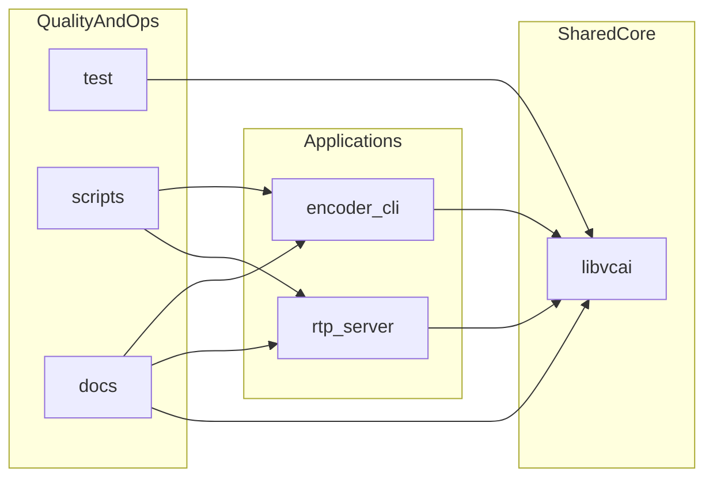
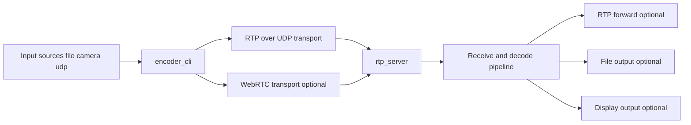

# Chapter 5 - Architecture atlas

This chapter provides a layered map of VCAI architecture and links to the detailed application chapters.
It treats **UDP/RTP** as the primary data-transfer mode and shows display paths as optional side branches.

## Level 1 - Repository architecture

## Level 1 - End-to-end runtime flow

## Reading guide by level

- **Level 1 (this chapter):** repository map and system runtime path.
- **Level 2 (application architecture):**
  - [**Chapter 13 - encoder_cli pipeline architecture**](../part03/ch13-pipeline-architecture.md)
  - [**Chapter 17 - rtp_server architecture**](../part04/ch17-architecture.md)
- **Level 3 (pipeline flows and mode variants):**
  - [**Encoder dataflow (end-to-end)**](../part03/encoder-end-to-end-dataflow.md)
  - [**Chapter 17 - rtp_server architecture**](../part04/ch17-architecture.md)

## Notes

- UDP/RTP is the default and recommended production data path.
- WebRTC is shown as an optional transport path.
- Display and file outputs are optional sinks and are not on the primary transfer path.
