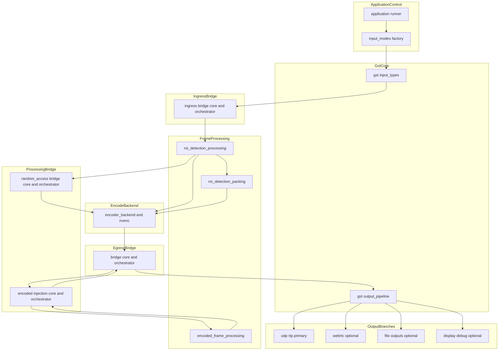

# Chapter 13 — encoder_cli pipeline architecture

This chapter is the **Level 2** view for `encoder_cli`.
For the repository-wide map, see [**Chapter 5 - Architecture atlas**](../part01/ch05-architecture-atlas.md).
For canonical and mode-variant pipeline flows, see [**Encoder dataflow (end-to-end)**](encoder-end-to-end-dataflow.md).

## Level 2 - Application architecture

## Application and GST layout

| Area | Path | Role |
|------|------|------|
| Application | [**application/**](../../encoder_cli/src/application/) | Runner, file/UDP modes, WebRTC connection, thread management |
| Input modes | [**application/input_modes/**](../../encoder_cli/src/application/input_modes/) | Factory + file/camera/UDP modes |
| GST core | [**gst/**](../../encoder_cli/src/gst/) | Pipeline, input/output pipelines, RTP utils |
| Input types | [**gst/input_types/**](../../encoder_cli/src/gst/input_types/) | Camera, file, UDP, frame router, ROI input, merger, drop manager, etc. |
| Ingress bridge | [**bridge/**](../../encoder_cli/src/bridge/) | Ingress boundary for `appsink` pull, callback/polling queue handoff, and idempotent queue-close lifecycle policy |
| Processing bridge | [**bridge/**](../../encoder_cli/src/bridge/) | Random-access period/frame processing and encoded SEI/EOI injection decomposition boundaries |
| Processing | [**processing/**](../../encoder_cli/src/processing/) | Encoded frame path, ROI detection packing/processing, branch FPS |
| App ports | [**bridge/app/**](../../encoder_cli/src/bridge/app/) + [**gst/output_pipeline/app/**](../../encoder_cli/src/gst/output_pipeline/app/) | Shared app-side adapter/controller boundaries for non-media side effects and output branch lifecycle orchestration |
| Memory contract | [**bridge/context/memory_policy_runtime.h**](../../encoder_cli/src/bridge/context/memory_policy_runtime.h) + [**processing/memory_contract_helper.***](../../encoder_cli/src/processing/) | Shared memory-domain and mutability contract layer: feature classification, writable/deep-copy fallback policy, and per-instance observability counters |
| Metadata contract | [**bridge/context/metadata_contract_runtime.h**](../../encoder_cli/src/bridge/context/metadata_contract_runtime.h) + [**gst/input_types/frame_path_meta.***](../../encoder_cli/src/gst/input_types/) | Strict per-frame sequence identity from ingress to encoded/output consumers; fail-fast on bundle mismatch/missing/invalid state |
| Egress bridge | [**bridge/**](../../encoder_cli/src/bridge/) | Egress boundary for `encoding_src`/`sei_src`: startup caps contract + one-way caps lock + push/EOS core + orchestrator + adapter |
| Worker lifecycle | [**application/**](../../encoder_cli/src/application/) + [**global_data**](../../encoder_cli/src/global_data.h) | Mode-agnostic worker-cycle runtime (`running`/`stopping`/`drained`), deterministic start/stop/join ordering, bypass polling restart/join contract |
| UDP / output probe runtime | [**global_data_instance_runtime.h**](../../encoder_cli/src/global_data_instance_runtime.h) + [**global_data.h**](../../encoder_cli/src/global_data.h) | Per-instance UDP packet + frame-probe counters, UDP frame-drop manager, display/debug reorder buffers, ROI border correlation ([**output_roi_sequence_correlation.***](../../encoder_cli/src/gst/output_pipeline/output_roi_sequence_correlation.h); strict path uses FIFO dequeue without fail-stop on empty queue), overlay/border-dump state; cleared on `reset_processing_state()` |
| Encoder backends | [**encoder_backend/**](../../encoder_cli/src/encoder_backend/) | GStreamer vs NVENC API backends; QP map payload |
| NVENC | [**nvenc/**](../../encoder_cli/src/nvenc/) | QP map support probing (`qp_map_delta` gating) |

## Output branches (`gst/output_pipeline/output_branches/`)

| Branch dir | Purpose |
|------------|---------|
| **debug** | Debug-only branch |
| **display** | On-screen display (FPS overlay, etc.) |
| **file_h265** | Raw H.265 elementary stream output |
| **file_mp4** | MP4 container output |
| **udp** | RTP/UDP send branch |
| **webrtc** | WebRTC output branch |

Shared plumbing: [**output_pipeline/**](../../encoder_cli/src/gst/output_pipeline/) — api (thin composition), app controller, paths, probes, queues, `rtp_branch`, branch factory.

## Processing subtree

- [**processing/encoded_frame_processing**](../../encoder_cli/src/processing/encoded_frame_processing.cpp) — path after encode (metadata, forwarding).
- [**processing/roi_detection_processing/**](../../encoder_cli/src/processing/roi_detection_processing/) — detection factory and modes; feeds ROI packing when enabled.
- [**processing/roi_detection_packing**](../../encoder_cli/src/processing/roi_detection_packing.h) — pack PRI for SEI injection.

DeepStream/YOLO wiring is via DeepStream config + [`encoder_cli/scripts/setup_yolo.sh`](../../encoder_cli/scripts/setup_yolo.sh) (see **Chapter 12**).

For threads, queues, packing modes, and background/QP-map mechanics, see **Chapters 14–16**.
