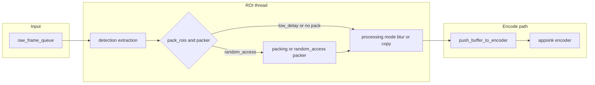

# Chapter 14 — encoder_cli architecture deep dive

This chapter complements **Chapter 13** (directory layout), **Encoder dataflow**, and **PRI and EOI SEI messages** with **threads, queues, and mode dispatch**. For “can I combine feature X and Y?” see **Part IX — Feature options**.

## High-level flow

Raw video frames enter a **queue** consumed by the ROI detection / processing thread. That thread either packs ROIs (when `pack_rois` and `background_mode == off`), applies a **background mode** (blur or QP map), or passes through. Processed buffers are pushed toward the encoder **appsink**; the **qp_map_delta** path can attach a **pending QP-map payload** per buffer instead of changing pixels.

## Main threads

| Thread / loop | Entry | Role |
|---------------|--------|------|
| ROI detection processing | `roi_detection_frame_processing` in [`encoder_cli/src/processing/roi_detection_processing/`](../../encoder_cli/src/processing/roi_detection_processing/) | Pops from `raw_frame_queue`, runs detection, then either delegates to **random_access** packer or to the active **processing mode**, then pushes to encoder. |
| Random access | `random_access_frame_processing` in [`encoder_cli/src/processing/roi_detection_random_access.cpp`](../../encoder_cli/src/processing/roi_detection_random_access.cpp) | Separate loop for **random_access** packer: waits for complete intraperiods and processes frames in each period sequentially (see **ROI packing modes**). |

When `pack_rois` is true and the active packing mode is **random_access**, `api.cpp` calls the packer’s `process_frame` first; if it handles the frame, the function **returns early** and the generic processing mode is skipped for that frame.

## Pipeline split (conceptual)

1. **Input** — file/camera/UDP → caps → optional inference → raw frames into the queue.
2. **Ingress bridge** — appsink callback/polling ingress (`pull-sample`, queue handoff, ingress EOS) flows through bridge core/orchestrator APIs instead of direct shared-state policy in callbacks.
3. **Processing bridge** — random-access period/frame handling and encoded SEI/EOI injection use dedicated core/orchestrator boundaries.
4. **ROI thread** — detection → (optional) packing → area copy / blur / QP-map generation.
5. **Encode** — `push_buffer_to_encoder` passes buffer + optional `pending_qp_map_payload` for the NvEncode/direct path.
6. **Egress bridge** — appsrc interactions (`encoding_src`, `sei_src`) flow through bridge core/orchestrator APIs instead of direct worker-side `gst_app_src_*` calls.

Code anchor: [`encoder_cli/src/processing/roi_detection_processing/api.cpp`](../../encoder_cli/src/processing/roi_detection_processing/api.cpp) — random_access branch (~149–159), then `get_active_processing_mode` and `process_frame` / `process_no_rois`, finally `push_buffer_to_encoder`.

## Ingress boundary model (appsrc/appsink mismatch mitigation)

The encoder now has an explicit ingress boundary under [`encoder_cli/src/bridge/`](../../encoder_cli/src/bridge/):

- `core/ingress_bridge_core.*` handles media-only appsink pull step outcomes (`ok`, `recoverable_drop`, `fatal_stop`, `drain_complete`).
- `orchestration/ingress_bridge_orchestrator.*` applies queue handoff, drop, and ingress EOS policy around core pull steps.
- `app/ingress_app_adapter.h` keeps non-media side effects (queue/counter updates and fail-fast stop signaling) out of core media code.
- `context/ingress_bridge_context.h` + `context/ingress_bridge_runtime.h` hold per-instance ingress lifecycle/counter state and probe PTS storage.

This removes callback-local static/shared state and keeps ingress policy instance-scoped for multi-pipeline safety.

## UDP input and output-branch instance runtime

UDP packet logging, frame-flow probes, adaptive frame dropping, and display/debug pad-probe mutable state live on
`global_data` (see [`encoder_cli/src/global_data_instance_runtime.h`](../../encoder_cli/src/global_data_instance_runtime.h)):

- `udp_input_runtime` — atomics for packets, sizes, last-packet time, and per-stage frame counters; `reset_udp_connection_state(global_data&)` clears packet-level stats for a new sender; `global_data::reset_processing_state()` also clears frame-probe counters.
- `udp_frame_drop_manager` — per-instance adaptive drop state; reset with processing lifecycle.
- `output_display_runtime` / `output_debug_runtime` — metadata bundle reorder maps, optional display border JSONL dump, FPS/bitrate overlay throttling, ROI correlation cursors (strict frame order when decoded PTS ≠ SEI registration), and warn-once flags; reset with `reset_processing_state()` so reconnects do not inherit another client’s probe state.

Public UDP helpers in [`encoder_cli/src/gst/input_types/udp_input.h`](../../encoder_cli/src/gst/input_types/udp_input.h) take an explicit `global_data` reference instead of using process-wide statics.

## Processing decomposition boundary model

For M3 decomposition, encoder processing hotspots now expose dedicated bridge modules under
[`encoder_cli/src/bridge/`](../../encoder_cli/src/bridge/):

- `core/random_access_bridge_core.*` + `orchestration/random_access_bridge_orchestrator.*` own random-access
  period/frame media handling and lifecycle handoff.
- `core/encoded_injection_bridge_core.*` + `orchestration/encoded_injection_bridge_orchestrator.*` own encoded-frame
  SEI/EOI transform decisions and egress push policy handoff.
- `context/random_access_bridge_context.h` and `context/encoded_injection_bridge_context.h` keep per-instance runtime
  wiring (packer/data refs and encoded frame-skip counters).

This keeps `roi_detection_random_access.cpp` and `encoded_frame_processing.cpp` as thin orchestration entry points
instead of mixed media+app blocks.

## Egress boundary model (appsrc/appsink mismatch mitigation)

The encoder now has an explicit egress boundary under [`encoder_cli/src/bridge/`](../../encoder_cli/src/bridge/):

- `core/encoded_bridge_core.*` handles media-only push/EOS results (`ok`, `recoverable_drop`, `fatal_stop`, `drain_complete`).
- `orchestration/encoded_bridge_orchestrator.*` applies policy and lifecycle handling around core steps.
- `orchestration/encoded_bridge_startup_contract.*` centralizes startup `appsrc` property/caps setup and establishes a
  one-way per-instance caps lock for `encoding_src` and `sei_src`.
- `app/encoder_app_adapter.h` keeps non-media side effects (status counters, fail-fast stop signaling) out of core media code.
- `context/encoder_bridge_context.h` + `context/encoder_bridge_runtime.h` hold per-instance endpoint wiring, startup
  markers, caps-lock runtime state, and EOS lifecycle state.

Push-time strictness is now fail-fast: if runtime `appsrc` caps diverge from the locked startup contract after lock,
core returns `fatal_stop` and orchestrator requests stop rather than renegotiating in-place.

Ingress and egress queue-close/restart handling now converges on idempotent lifecycle helpers in
[`encoder_cli/src/global_data.cpp`](../../encoder_cli/src/global_data.cpp), so duplicate EOS/flush paths do not drift
or reopen contract state accidentally mid-cycle.

## App adapter/controller separation model

After M8 mixed-concern separation, hot media loops and output lifecycle wiring use explicit app ports:

- `bridge/app/pipeline_app_adapter.h` centralizes processing-loop non-media side effects (status/perf reporting,
  metadata-contract fail-fast signaling, and lifecycle queue-close/watchdog helpers).
- `processing/roi_detection_processing/api.cpp`, `processing/encoded_frame_processing.cpp`, and metadata-sensitive
  processing/orchestration paths call adapter methods instead of directly mutating broad app/reporting state.
- `gst/output_pipeline/app/output_branch_controller.*` owns output branch lifecycle order: enabled-branch selection,
  element creation/configuration, optional signal setup, add/link sequencing, and no-branch fakesink fallback.
- `gst/output_pipeline/api.cpp` remains the entrypoint, but now composes startup contract + tee setup + controller
  orchestration rather than embedding branch lifecycle loops inline.

This keeps media core logic focused while preserving existing startup/link/fail-fast behavior.

## Worker lifecycle contract model

After M5 lifecycle-first hardening, mode execution uses a shared worker contract:

- `application/thread_management.*` exposes a mode-agnostic worker bundle API (`start_worker_threads` returns a
  `std::unique_ptr<worker_thread_bundle>` for stable GstTask slot addresses; `wait_for_worker_threads_completion` joins it).
  The bundle holds **`GstTask`** slots for ROI detection, optional random-access processing, encoded-frame processing, and
  optional input/output pipeline bus workers (`roi_detection_slot`, `random_access_slot`, `encoded_frame_slot`,
  `input_message_slot`, `output_message_slot`).
- `application/worker_lifecycle_runtime.h` provides per-instance runtime phase tracking (`idle` -> `running` ->
  `stopping` -> `drained`) and generation-based stop semantics.
- `global_data::request_worker_stop_once(...)` is the authoritative stop path used by worker orchestration and fail-fast
  adapters, unifying stop/queue-close transitions.
- bypass polling lifecycle (`appsink` inference/bypass + merger consumer) now has explicit restart/join hooks through
  thread management, and restart paths recreate the frame merger if it was drained/closed.

This removes mode-local ad-hoc stop/join ordering and makes restart cycles (`reset_processing_state`) deterministic for
both normal and bypass-enabled paths.

## Memory-domain and mutability contract model

After M6 hardening, CPU-bound ingress/processing/egress stages share a single memory contract layer:

- `bridge/context/memory_policy_runtime.h` tracks per-instance counters for memory-domain fallback conversions,
  writable-buffer fallback conversions, and fallback failures.
- `processing/memory_contract_helper.*` centralizes memory-feature classification and controlled fallback decisions.
- ROI PTS restoration (`gst/input_types/roi_input/roi_input_pts_probes.cpp`) uses explicit writable-buffer fallback
  (`gst_buffer_make_writable`) through
  the helper and updates counters when copies are required.
- Raw and encoded CPU-map paths use deep-copy fallback before terminating/dropping (`frame_processing_utils.cpp` and
  `encoded_injection_bridge_core.cpp`), so copy semantics are explicit and measurable.
- Startup memory expectations are captured at encode upload contract points (`input_pipeline.cpp`) and runtime counters
  are exported through existing monitoring (`performance_monitor` via `memory_monitor`) and status reporting paths.

This removes silent mutability assumptions and makes fallback pressure observable during migration baselining.

## Metadata contract model

After M7 hardening, metadata association is no longer inferred from optional PTS side channels or FIFO assumptions:

- `bridge/context/metadata_contract_runtime.h` tracks strict per-instance sequence state for raw, encoded, display, and
  debug consumers, plus mismatch/validation/fail-stop counters.
- `gst/input_types/frame_path_meta.*` carries both frame-path identity and contract sequence id; ingress assignment is
  deterministic and map-based fallback paths are removed.
- Metadata queues now carry `metadata_frame_bundle` (sequence + payload), replacing implicit queue-only sync for PRI and
  output border consumers.
- `bridge/orchestration/encoded_injection_bridge_orchestrator.*` binds encoded samples to metadata bundles by sequence
  and fail-stops on missing bundle, out-of-order bundle, or invalid contract state.
- Display/debug output probes resolve `metadata_frame_bundle.sequence_id` in order: **PTS map** (keys from SEI-path
  `register_output_sequence`), else **`frame_path_meta` on the decoded buffer** when elements copy it through parse/decode,
  else **FIFO dequeue** from `display_regions_queue` / `debug_regions_queue` (cursor
  `display_roi_correlation_next_sequence` / `debug_roi_correlation_next_sequence` is advanced from the dequeued bundle’s
  `sequence_id`). The strict-order path logs a one-time warning because dropped or reordered frames could desynchronize
  borders; an empty queue only skips drawing (no metadata fail-stop). **PTS/meta** correlation still uses sequence-keyed
  dequeue plus fail-stop when the bundle is missing.

This makes metadata ownership and ordering explicit across ingress bypass routing, encoded injection, and output branch
consumers.

## Background mode vs packing

- **`background_mode != off`** — packing is disabled (validator enforces); blur or QP-map path owns the buffer (blur allocates internally; see **Background modes and QP map**).
- **`pack_rois` with `background_mode off`** — packed layout + PRI path toward SEI (see **PRI and EOI SEI messages**).

## Luma adaptation (orthogonal)

Configured under `[ROI]` as `enable_luma_adaptation` and `luma_downscale_factor` ([`encoder_cli/encoder_config.ini`](../../encoder_cli/encoder_config.ini)). When enabled:

- Y plane is down-scaled before encode.
- **EOI luma adaptation** metadata is emitted on IRAP frames ([`encoder_cli/src/encoder_config.h`](../../encoder_cli/src/encoder_config.h) documents the workflow).

It is orthogonal to `pack_rois` in the validator and can combine with **background_blur** / **qp_map_delta** for object-based EOI on IRAP when both are effective (see [**encoder_cli/README.md**](../../encoder_cli/README.md) and **Part IX**).

## Other ROI knobs (pointers only)

| Concern | Where to look |
|--------|----------------|
| Margin before CTU packing | `roi_fixed_margin_px`, `roi_margin_mode` — loaded in [`encoder_cli/src/encoder_config_loader.cpp`](../../encoder_cli/src/encoder_config_loader.cpp) |
| Temporal resampling | `temporal_resampling` — reduces ROI update rate |
| Inference vs static | `roi_manager`, detection modes in `roi_detection_processing` |

## Related

- **Chapter 23** — libvcai is linked as `encoder_cli_vcai` (background_blur, area_copy, nal_utils).
- **Part IX** — compatibility matrix.
- **Config reference — ROI** — `config/encoder_config-roi.md`.
