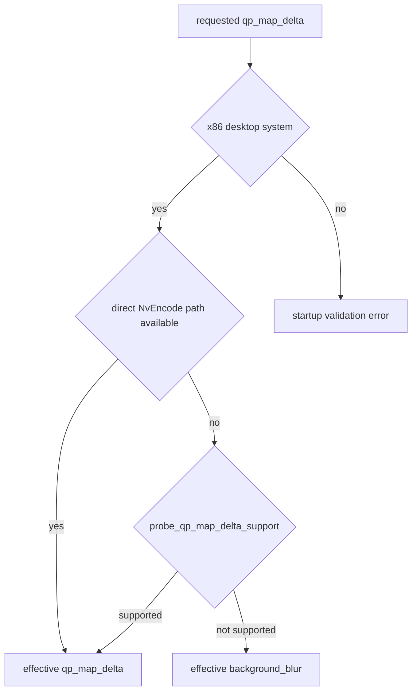

# Chapter 16 — Background modes and QP map

`background_mode` selects what happens **outside** ROIs before encode: **off** (packing allowed), **background_blur**, or **qp_map_delta**. Part IX documents compatibility; this page describes **mechanics and algorithms** at a high level.

## Mutual exclusion with packing

Any **non-off** `background_mode` forces packing off — the bitstream no longer follows the single reconstruction path packing assumes. Config validation enforces this (`encoder_config_validator` / Part IX matrix).

## background_blur

**Algorithm:** Separable **Gaussian blur** — horizontal pass then vertical pass over the frame. Pixels **inside** the ROI rectangles are **not** modified; only background is blurred. Complexity is linear per pixel per pass (O(n)) instead of a full 2D kernel O(n²).

**API:** `sf::apply_background_blur` in [`libvcai/include/background_blur.h`](../../libvcai/include/background_blur.h) — parameters include `sigma`, optional `kernel_size` (0 = auto from sigma: `2 * ceil(3 * sigma) + 1`, odd), format, width/height.

**Encoder integration:** When effective background blur is active, the ROI thread does **not** use the preallocated output buffer path the same way — blur owns output allocation internally ([`encoder_cli/src/processing/roi_detection_processing/api.cpp`](../../encoder_cli/src/processing/roi_detection_processing/api.cpp) ~130–137).

**Config:** `sigma`, `kernel_size` under `[ROI]`; see **Part IX** background_blur examples.

## qp_map_delta

**Idea:** Leave **pixels unchanged**; instead, supply a **per-CTB QP delta map** so the encoder spends fewer bits on background CTBs and more on ROI CTBs. `qp_map_background_delta` adds delta on background-only CTBs (default 10 in many configs).

**Platform scope:** `qp_map_delta` is supported only on **x86 desktop systems**. On non-x86 systems, requesting `background_mode=qp_map_delta` fails at startup with a validation error.

**Runtime gating:**

1. **Platform validation** — `validate_configuration(...)` in [`encoder_cli/src/encoder_config_validator.cpp`](../../encoder_cli/src/encoder_config_validator.cpp) rejects `background_mode=qp_map_delta` on non-x86 systems.
2. **Probe** — `probe_qp_map_delta_support(encoder)` in [`encoder_cli/src/nvenc/qp_map_support.cpp`](../../encoder_cli/src/nvenc/qp_map_support.cpp) (declared in [`encoder_cli/src/nvenc/qp_map_support.h`](../../encoder_cli/src/nvenc/qp_map_support.h)). Requires **x86**, encoder element resembling **nvh265enc** with QP-map-like properties. Returns `supported`, `detected_ctb_size`, and `reason` on failure.
3. **Resolve** — `resolve_effective_background_mode` sets effective mode to **background_blur** when probe fails and logs why.
4. **Direct NvEncodeAPI path** — [`encoder_cli/src/gst/input_pipeline.cpp`](../../encoder_cli/src/gst/input_pipeline.cpp) (~368–381) can select a **direct backend** when `qp_map_delta` is requested and the GStreamer encoder path does not expose QP map; if that path is active, CTB size is stored and blur fallback is avoided when supported.

If you request `qp_map_delta` but observe blur-like results, check logs for fallback warnings.

## Fallback chain



## CTB grid (conceptual)

QP map is aligned to encoder **CTB** grid (size probed, often 64). Background delta is applied per CTB classified as background; ROIs keep base QP. Exact buffer layout is API-specific — document at this level unless you maintain NvEncode-specific tables.

## Config snippet (background_mode block)

```ini
--8<-- "encoder_cli/encoder_config.ini:285:320"
```

## Related

- **libvcai** — `background_blur` implementation under [`libvcai/src/background_blur/`](../../libvcai/src/background_blur/) (**Chapter 23**).
- **Troubleshooting FAQ** — why ROI packing conflicts with blur/qp_map; why qp_map fails on non-x86 or falls back on x86.
- **Part IX** — CLI/ini and trade-offs.
