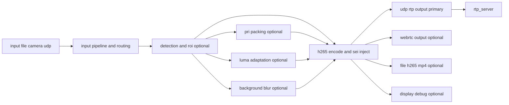
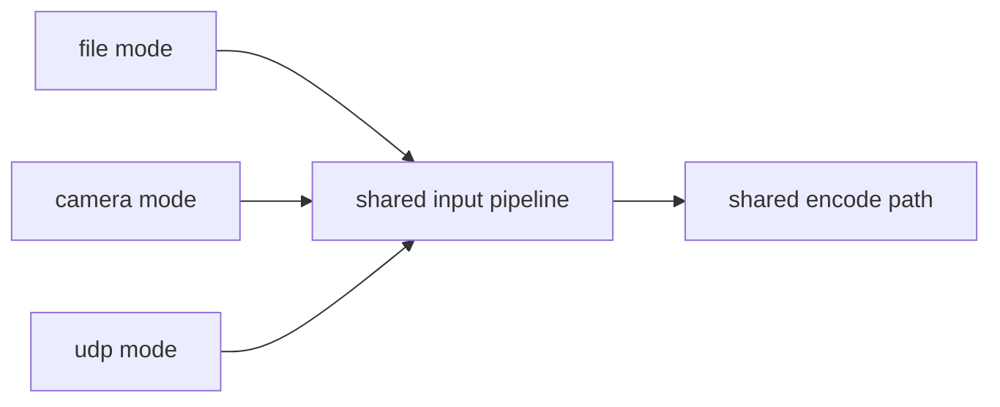
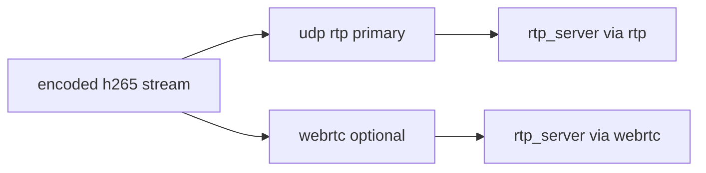

# Encoder dataflow (end-to-end)

Companion to **Chapter 13** (directory layout) and **Chapter 17** (rtp_server dataflow). This page is **conceptual**: exact element names live in code and config.
For the repository-level context, see [**Chapter 5 - Architecture atlas**](../part01/ch05-architecture-atlas.md).

## Level 3 - Canonical encoder pipeline (primary path)

```text
[Input: file | camera | UDP]
        │
        ▼
[Input pipeline + frame routing]
        │
        ▼
[Optional detection / ROI] ──► [ROI packing → PRI]
                         ├──► [Luma adaptation]
                         └──► [Background blur]
                                │
                                ▼
                         [SEI inject at encode]
        │
        ▼
[Encode H.265 + SEI]
        │
        ▼
[UDP / RTP output] ──► [rtp_server]
```



## Level 3 - Mode variants

### Input mode variants



### Output transport variants



## Where each stage lives (package map)

| Stage | Typical location |
|-------|------------------|
| Mode + run loop | [**application/**](../../encoder_cli/src/application/) |
| File/camera/UDP input | [**application/input_modes/**](../../encoder_cli/src/application/input_modes/), [**gst/input_types/**](../../encoder_cli/src/gst/input_types/) |
| Detection → ROI | [**processing/roi_detection_processing/**](../../encoder_cli/src/processing/roi_detection_processing/) |
| Pack PRI for SEI | [**processing/roi_detection_packing**](../../encoder_cli/src/processing/roi_detection_packing.h) |
| Encode + inject | [**encoder_backend/**](../../encoder_cli/src/encoder_backend/), GStreamer payloader/encoder chain |
| Output selection | [**gst/output_pipeline/**](../../encoder_cli/src/gst/output_pipeline/), [**output_branches/**](../../encoder_cli/src/gst/output_pipeline/output_branches/) |

## Related

- **PRI and EOI SEI messages** — how PRI and EOI become SEI NALs and enter the access unit.
- **Chapter 11** — CLI flags that affect input/output modes.
- **Config reference** — [`encoder_cli/encoder_config.ini`](../../encoder_cli/encoder_config.ini) sections tied to branches and ROI.
