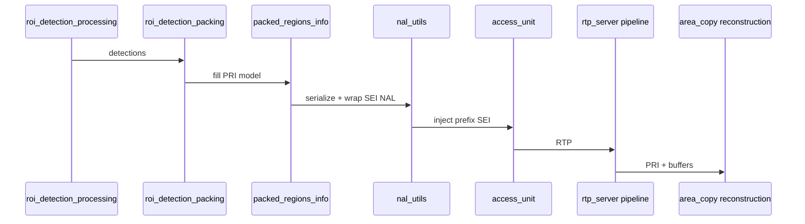

# PRI and EOI SEI messages

VCAI carries **Packed Regions Information (PRI)** and **Encoder Optimization Information (EOI)** in H.265 **prefix SEI** so receivers can reconstruct ROI layouts, apply luma back-scaling, and run evaluation consistently. This page summarizes both **algorithmic paths** and points to the code; it does not replace the standards text or every Doxygen block.

## PRI (Packed Regions Information)

### What PRI carries

The PRI payload describes **regions** (rectangles) in the frame: each region has optional id, layer, position and size in units, and optional resampling or target-placement fields. A **cancel_flag** indicates “no ROIs for this frame.” Optional **target picture** dimensions and **resampling ratios** support packed layouts. Full syntax is in [`libvcai/include/packed_regions_info.h`](../../libvcai/include/packed_regions_info.h) (`sf::packed_regions_info`, `sf::region`, `resampling_ratio`).

### Stages (encoder → wire → receiver)

1. **Model** — In-memory PRI structure: [`libvcai/include/packed_regions_info.h`](../../libvcai/include/packed_regions_info.h) (`sf::packed_regions_info` and related types). Serialize/deserialize helpers live alongside the struct definitions.
2. **Pack from detections** — Encoder-side ROI path packs detections into the PRI model ([`encoder_cli/src/processing/roi_detection_packing.h`](../../encoder_cli/src/processing/roi_detection_packing.h) and related processing). When ROI packing is off, this path is skipped.
3. **Serialize payload** — Bitstream writer builds the SEI payload bytes (type + size + RBSP) using `libvcai` bitstream utilities; see [`packed_regions_info.cpp`](../../libvcai/src/packed_regions_info.cpp) and [`bitstream.h`](../../libvcai/include/bitstream.h).
4. **Wrap as prefix SEI NAL** — [`libvcai/include/nal_utils.h`](../../libvcai/include/nal_utils.h) / [`nal_utils.cpp`](../../libvcai/src/nal_utils.cpp):
   - Build a complete prefix SEI NAL (header + payload + stop bit) without start code.
   - **Inject** that NAL into an H.265 access unit before the slice NAL(s) where the bitstream format requires it.
5. **On the wire** — RTP depay enters the plugin path where `sfh265seiextract` extracts PRI/EOI for downstream decode stages.
6. **Reconstruct** — [`libvcai/include/area_copy.h`](../../libvcai/include/area_copy.h) reconstruction APIs use PRI metadata to rebuild full frames where the pipeline uses packed/subset frames. Implementation under [`libvcai/src/area_copy/reconstruction/`](../../libvcai/src/area_copy/reconstruction/) (e.g. [`pri_extraction.h`](../../libvcai/src/area_copy/reconstruction/pri_extraction.h)).

## Mermaid (data path only)

### Why SEI (short)

- **In-band** with the video: no side channel required for ROI geometry per frame.
- **Prefix SEI** placement keeps metadata aligned with the access unit the decoder consumes.
- **Receiver** can parse the same message type after depay; reconstruction and TET then share one source of truth.

## EOI (Encoder Optimization Information)

**EOI** is H.274 8.31 Encoder Optimization Information SEI. The struct in [`libvcai/include/encoder_optimization_info.h`](../../libvcai/include/encoder_optimization_info.h) supports several **type** flags (object-based, temporal/spatial resampling, luma adaptation, privacy, etc.). VCAI uses **luma adaptation** in EOI to signal how the encoder down-scaled luma so the receiver can back-scale correctly.

### Encoder path (EOI luma adaptation)

1. When **luma adaptation** is enabled (`enable_luma_adaptation`, `luma_downscale_factor` in `[ROI]`), the encoder down-scales the Y plane before encoding. With **adaptive** luma (`enable_adaptive_luma_adaptation`, `input_analyzer_model_path`), an ONNX input analyzer predicts per-frame (or per-keyframe) downscale and upscale factors; otherwise the fixed `luma_downscale_factor` is used.
2. For IRAP frames, the encoder builds an **EOI** payload: `sf::derive_luma_adaptation_signal(luma_downscale_factor, luma_upscale_multiplier)` in [`luma_adaptation_math.h`](../../libvcai/include/luma_adaptation_math.h) yields ratio/backscale fields (when an explicit upscale multiplier is provided, the backscale value encodes it; otherwise full backscale 1/d is used); these are written into `sf::encoder_optimization_info` (e.g. `type_luma_adaptation`).
3. Payload is serialized with `sf::write_encoder_optimization_info` and wrapped as a prefix SEI NAL via `sf::create_sei_nal_unit(215, eoi_payload)` (215 = EOI payload type); the NAL is injected into the access unit. See [`encoder_cli/src/processing/encoded_frame_processing.cpp`](../../encoder_cli/src/processing/encoded_frame_processing.cpp) and tests in [`test/encoder_cli/test_processing_functions.cpp`](../../test/encoder_cli/test_processing_functions.cpp).
4. Object-based EOI (e.g. for ROI/background modes) can be combined with luma adaptation on the same IRAP when both are effective.

### Receiver path (EOI luma back-scaling)

1. **sfh265seiextract** extracts EOI SEI along with PRI in the encoded path.
2. The receiver uses EOI luma fields to **back-scale** luma after PRI reconstruction: `sf::compute_luma_backscale_multiplier` in [`luma_adaptation_math.h`](../../libvcai/include/luma_adaptation_math.h) derives the multiplier from the ratio and backscale values.
3. Pipeline order: decode → reconstruction → **EOI-driven luma back-scaling** → TET (if enabled) → OSD → display/file. See **Chapter 17** and **Chapter 18**.

### Plugin split path (`vcai_decoder`)

For the open-source decoder plugin path, the same decode stages are exposed as independent elements:

- `sfh265seiextract` (encoded path producer)
- `sfprireconstruct` (decoded PRI reconstruction)
- `sfeoilumabackscale` (decoded EOI luma)
- `sftetapply` (decoded TET, `I420` execution path)

The plugin bridges encoded and decoded stages through a bounded sync store keyed by frame identity (`stream-id + PTS`,
with `DTS`/`offset` fallback). Recommended order:

`sfh265seiextract ! <decoder> ! sfprireconstruct ! sfeoilumabackscale ! sftetapply`

### EOI code pointers

- [`libvcai/include/encoder_optimization_info.h`](../../libvcai/include/encoder_optimization_info.h) — EOI struct and type flags; `write_encoder_optimization_info` / `read_encoder_optimization_info`.
- [`libvcai/include/luma_adaptation_math.h`](../../libvcai/include/luma_adaptation_math.h) — `derive_luma_adaptation_signal`, `derive_luma_ratio_percentage`, `compute_luma_backscale_multiplier`.
- [`libvcai/include/nal_utils.h`](../../libvcai/include/nal_utils.h) — `create_sei_nal_unit(payload_type, payload)` for any SEI (PRI and EOI use different payload types).
- Encoder injection: [`encoder_cli/src/processing/encoded_frame_processing.cpp`](../../encoder_cli/src/processing/encoded_frame_processing.cpp).

## Related chapters

| Topic | Where |
|-------|--------|
| Receiver pipeline stages (PRI/EOI extraction, luma before TET) | **Chapter 17** |
| rtp_server modes (TET, luma back-scaling order) | **Chapter 18** |
| Luma adaptation encoder-side (enable_luma_adaptation, IRAP) | **Chapter 14** |
| Build-time lib split (who links nal_utils) | **Chapter 23** |
| ROI vs background_blur / qp_map | **Troubleshooting FAQ**, **Part IX** |
| TET framework | **Chapter 25** |

## Code pointers (read-only)

**PRI**

- [`libvcai/include/packed_regions_info.h`](../../libvcai/include/packed_regions_info.h) — PRI model and payload.
- [`libvcai/include/nal_utils.h`](../../libvcai/include/nal_utils.h) — SEI NAL create/inject.
- [`libvcai/include/area_copy.h`](../../libvcai/include/area_copy.h) — reconstruction from PRI.
- [`encoder_cli/src/processing/roi_detection_packing.h`](../../encoder_cli/src/processing/roi_detection_packing.h) — encoder pack path.
- [`libvcai/src/area_copy/reconstruction/pri_extraction.h`](../../libvcai/src/area_copy/reconstruction/pri_extraction.h) — PRI → rectangles for reconstruction.

**EOI** — see the EOI subsection above.
