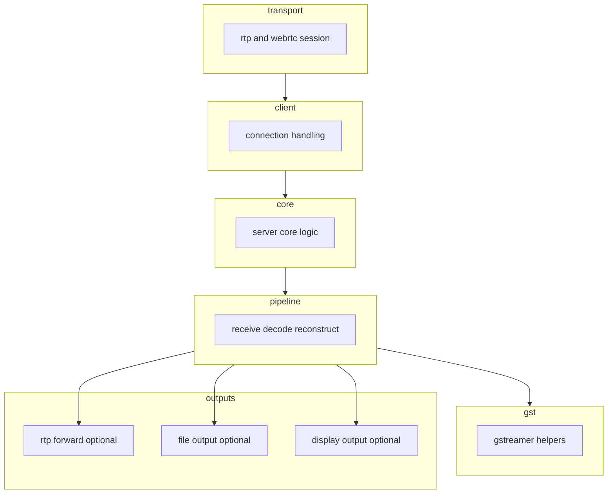
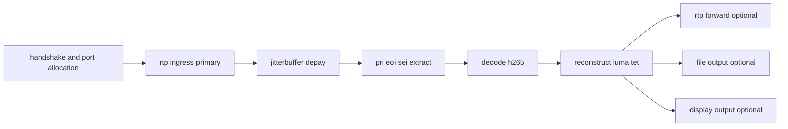
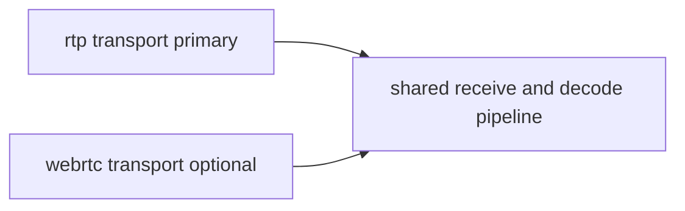

# Chapter 17 - rtp_server architecture

This chapter is the **Level 2 + Level 3** view for `rtp_server`.
For the repository-wide map, see [**Chapter 5 - Architecture atlas**](../part01/ch05-architecture-atlas.md).

## Level 2 - Application architecture ([`rtp_server/src/`](../../rtp_server/src/))

| Directory | Role |
|-----------|------|
| **transport** | RTP input and WebRTC transport setup |
| **client** | Per-client connection handling |
| **core** | Handshake, port allocation, server orchestration |
| **pipeline** | Receive/decode/overlay pipeline construction |
| **gst** | GStreamer utilities shared by pipeline code |
| **utils** | Helpers |

## Level 3 - Canonical receive pipeline (primary path)

## Level 3 - Transport variants

Pipeline stages in plain terms: **handshake** -> **udpsrc / jitterbuffer / depay** -> **h265parse (PRI/EOI)** -> **decode (nvh265dec / openhevcdec)** -> **reconstruction / luma / TET** -> optional **RTP forward / file / display**.

## TET and Test mode in the pipeline

**TET (Tile Enhancement Tiles)** runs after PRI reconstruction and optional EOI luma back-scaling, before OSD. When enabled (`[TET] enabled`), it applies tile-based post-processing from the configured tile file and QP; when disabled, that stage is a pass-through. **Test mode** (groundtruth evaluation) is separate: it compares display-branch detections to COCO groundtruth and is implemented under [`rtp_server/src/pipeline/output/display/`](../../rtp_server/src/pipeline/output/display/) (`test_mode_*`); it is active when `[TestMode] groundtruth_file` is set. For a full list of modes (transport, WebRTC signaling, TET, Test mode, RTP output, file, debug, decoder, inference, monitoring), see **Chapter 18**. For the TET comparison framework and BD-rate scripts, see **Chapter 25**; for PRI and EOI on the encoder side, see **PRI and EOI SEI messages** (Part III).
