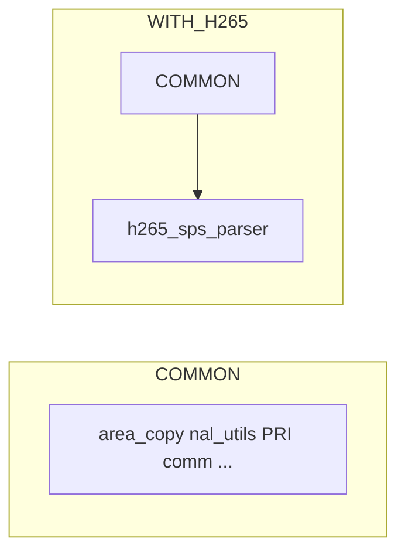
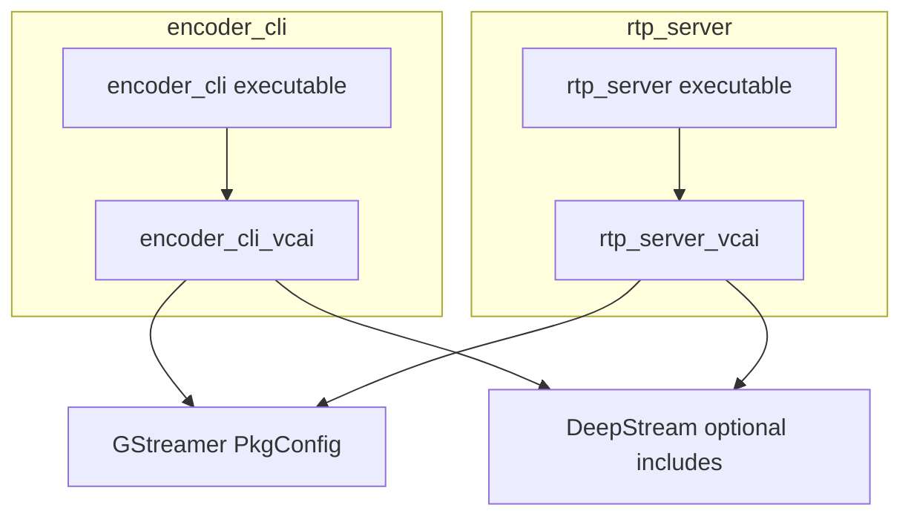

# Chapter 23 — Build-time and runtime dependencies

This chapter complements **Chapter 19 (Part V)** (what libvcai provides) and **Chapter 22** (source map) with **how** each application pulls in that code and **why** the two shared-library targets differ.
For the repository-level runtime context and layered architecture entry points, see [**Chapter 5 - Architecture atlas**](../part01/ch05-architecture-atlas.md).

## libvcai source sets (CMake)

The canonical list is [`libvcai/libvcai_sources.cmake`](../../libvcai/libvcai_sources.cmake):

- **`LIBVCAI_SOURCES_COMMON`** — full shared core: area_copy (pack/reconstruct), `nal_utils`, `packed_regions_info`, communication, background_blur, text_drawer, etc.
- **`LIBVCAI_SOURCES_WITH_H265`** — **COMMON** plus `h265_sps_parser.cpp` only.



### Why encoder_cli uses COMMON only

[`encoder_cli/CMakeLists.txt`](../../encoder_cli/CMakeLists.txt) builds:

```text
add_library(encoder_cli_vcai SHARED ${LIBVCAI_SOURCES_COMMON})
```

The encoder path does not need SPS/PPS parsing for base-QP extraction in the same way the receive/decode path does; keeping the shared library smaller avoids pulling `h265_sps_parser` into the encoder binary’s link when unused.

### Why rtp_server uses WITH_H265

[`rtp_server/CMakeLists.txt`](../../rtp_server/CMakeLists.txt) builds:

```text
add_library(rtp_server_vcai SHARED ${LIBVCAI_SOURCES_WITH_H265})
```

The receiver pipeline parses incoming H.265 bitstream headers (SPS/PPS) for QP-related metadata via `sf::parse_sps_for_qp` and NAL typing via `sf::get_nal_unit_type` — see [`libvcai/include/h265_sps_parser.h`](../../libvcai/include/h265_sps_parser.h). That logic lives only in the **WITH_H265** set.

!!! note "Test targets"
    `test/` builds both `test_vcai` and `test_rtp_server_vcai` from the same cmake lists — mirror the encoder vs rtp_server split when adding tests that need SPS parsing.

## Executable → shared library (build graph)



Both shared libraries link **GStreamer** (app, video, sdp, gio) and optionally **DeepStream** include/lib paths when found. **encoder_cli** also wires **DeepStream-Yolo** link path for the detector path; **rtp_server** links the same Yolo path for consistency.

## Runtime module coupling (package level)

### encoder_cli

High-level call direction (not every symbol):

```text
application/  →  gst/  →  processing/  →  encoder_backend/
     ↑              ↑            ↑
 input_modes/   input_types/   roi_detection_* / encoded_frame_processing
     ↓
 output_pipeline/ + output_branches/  (udp, webrtc, file_*, display, debug)
```

- [**application/**](../../encoder_cli/src/application/) owns run loop, mode selection, WebRTC session wiring.
- [**gst/**](../../encoder_cli/src/gst/) owns pipeline construction, probes, branch factory.
- [**processing/**](../../encoder_cli/src/processing/) owns post-encode metadata and ROI packing when enabled.
- [**encoder_backend/**](../../encoder_cli/src/encoder_backend/) chooses GStreamer vs NVENC API and QP-map payload paths.

See **Chapter 13** for directory tables and **Encoder dataflow** (Part III) for the end-to-end diagram.

### rtp_server

```text
transport/  →  client/  →  core/  →  pipeline/  →  gst/
```

- [**transport/**](../../rtp_server/src/transport/) — RTP and WebRTC session setup.
- [**client/**](../../rtp_server/src/client/) — per-client connection handling.
- [**core/**](../../rtp_server/src/core/) — handshake, port allocation, orchestration.
- [**pipeline/**](../../rtp_server/src/pipeline/) — receive, depay, parse (PRI/EOI), decode, reconstruction/TET, OSD, display/file.

See **Chapter 17** for the stage list and layering diagram.

## Related chapters

| Topic | Chapter |
|-------|--------|
| Repository-level architecture and runtime path | **Chapter 5** |
| PRI/EOI SEI messages | Encoder — **PRI and EOI SEI messages** |
| Pipeline stages (receiver) | **Chapter 17** |
| Feature/options matrix | **Part IX** |
| CMake subprojects | **Chapter 4** |
